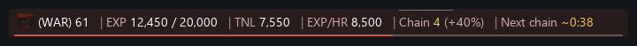

# Momentum

Momentum is an Ashita v4 addon for Phoenix. It puts EXP, merit points, session progress, and Dynamis runs in a compact bar above or below chat, or anywhere you want to drag it. Choose the readings, arrange them, and change the labels, dividers, and colors.

Author: **Kipling**.

*Example EXP layout with sample values.*

[Download the latest release](https://github.com/KiplingFFXI/momentum/releases/latest) | [Full guide](docs/GUIDE.md) | [What's changed](CHANGELOG.md)

## Install or update

1. Download `momentum-<version>.zip` from the release page.
2. If Momentum is running, type `/addon unload momentum` before replacing its files.
3. Extract the `momentum` folder into your Phoenix `addons` folder. You should have `addons/momentum/momentum.lua`.
4. Type `/addon load momentum`.

Updates replace `addons/momentum/`. Leave `config/addons/momentum/` in place; it holds your settings, profiles, session and Dynamis history, and custom sounds.

## Start here

Type `/momentum` to open settings. Use **Bar mode** at the top to choose **EXP**, **Merits**, or **Dynamis**. Your choice stays selected until you change it. Choose **Automatic** to follow your automatic layout settings again. Escape closes settings, including during combat or while editing a field.

- **Display** holds starter layouts, readouts, ordering, labels, dividers, and alignment. EXP, Merits, and Dynamis keep their own readout setups. **Position and size** attaches the bar above or below chat. Choose **Free placement**, then hold Shift to drag or resize it.
- **Appearance** holds eight skins, colors, fonts, and text sizes. Job pictures come from your client, with the abbreviation and level beside them, such as `(WAR) 32`.
- **Live/Sample** previews let you try a layout. Search finds settings, and hover help explains controls and readings. **Undo** restores recent edits; **Profiles** saves setups for different jobs or shared use.
- **Alerts** groups notices and sounds by purpose and shows how many are on. All start off. For a food wear-off sound, open **Food** and check **Play sound** under **Food effect wore off**. [Set up alerts](docs/GUIDE.md#alerts).
- **Dynamis** follows your Perpetual Hourglass, time extensions, currency, and relic armor. With Bar mode set to Automatic, **Switch layouts in Dynamis** uses its compact layout in Dynamis and restores your regular layout afterward. Tracking keeps running when you select another bar mode. [Dynamis tracking and limits](docs/GUIDE.md#dynamis).

**Pause session** excludes session gains and time while current balances keep updating. **Reset session** saves the old record and clears EXP/HR, LP/HR, and Next until new data is collected. Neither action clears or restarts active EXP chain, food, Dedication, or EXP ring recast timers. Dynamis timing and totals keep running too. Paused alerts follow **When to mute alerts**. Your current points and layout stay the same. [Sessions and saving](docs/GUIDE.md#sessions).

## What it can show

- Current EXP, TNL, EXP/HR, progress, and estimated time to the next level.
- LP/HR, LP toward the next merit, stored merit points and capacity, free slots, and merits earned this session.
- EXP chain numbers, bonuses, and a countdown with a configurable warning color.
- Session gains, losses, recovery, recent averages, goals, and saved history.
- Food and Dedication timers, EXP ring charges and recast, and optional notices or sounds.
- Level Sync details and a separate Phoenix penalty calculator.
- Dynamis time left, time extensions, currency, relic armor, observed objectives, and saved runs.

Rates need one minute of session time. Merit tracking keeps earned points separate from spending; full storage shows **Spend merits** before another conversion. Bar mode only changes what Momentum shows. It never changes your EXP/merit mode in the game or resets a session, run, or timer. [Choosing a bar mode](docs/GUIDE.md#choose-a-bar-mode).

Unknown values stay `--`; estimates use `~`. The local EXP chain timer follows Phoenix's rules, but the chain may stay open longer when the monster's EXP level is unknown. Exact applied Level Sync penalties and remaining Dedication bonus EXP need optional server reports. The calculator does not replace an unknown applied penalty. [Tracking limits](docs/GUIDE.md#exp-lp-and-rates) | [Phoenix status and planning](docs/GUIDE.md#phoenix-status-and-planning).

Momentum reads client state and incoming packets. It sends no gameplay commands, uses no items, and works without server changes. Dynamis needs no server companion. Settings and run records stay local.

## Source and license

Rules follow [Phoenix's source](https://github.com/phoenixffxi/Phoenix). Momentum uses [GPL-3.0-or-later](LICENSE). The bundled Final Fantasy VII and Final Fantasy IX sounds and the job artwork in the example belong to Square Enix. The sounds have a separate [notice](momentum/sounds/README.txt). The addon reads job pictures from your installed client; standalone job artwork is not included in its archive.

See [Contributing](CONTRIBUTING.md) for source setup and checks.
