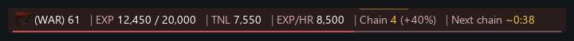

# Momentum

Momentum is an Ashita v4 addon for Phoenix. It puts EXP, merit points, farming drops and item rates, gil, Inventory and Mog Satchel space, zone time, and event progress in a compact bar above or below chat, or anywhere you want to drag it. Choose the readings, arrange them, and change the labels, dividers, and colors.

Author: **Kipling**.

*Example EXP layout with sample values.*

[Download the latest release](https://github.com/KiplingFFXI/momentum/releases/latest) | [Full guide](docs/GUIDE.md) | [What's changed](CHANGELOG.md)

## Install or update

1. Download `momentum-<version>.zip` from the release page.
2. If Momentum is running, type `/addon unload momentum` before replacing its files.
3. Extract the `momentum` folder into your Phoenix `addons` folder. You should have `addons/momentum/momentum.lua`.
4. Type `/addon load momentum`.

Momentum starts about three seconds after your character is ready in-game. This also applies when loading it from the launcher or reloading it during play.

Updates replace `addons/momentum/`. Leave `config/addons/momentum/` in place; it holds your settings, profiles, session and event history, recorded cooldowns, and custom sounds.

## Start here

Type `/momentum` to open settings. Use **Bar mode** at the top to choose **EXP**, **Merits**, **Farming**, **Dynamis**, **Assault**, **Limbus**, **BCNM**, **KSNM**, or **ENM**. Your choice stays selected until you change it. Choose **Automatic** to follow your automatic layout settings again. Escape closes settings, including during combat or while editing a field.

- **Display** holds starter layouts, readouts, ordering, labels, dividers, and alignment. Every mode keeps its own readout setup. **Switch saved EXP / Merits layouts** lets Automatic use the same EXP and Merits layouts you arrange manually. **Position and size** attaches the bar above or below chat, with an optional compact centered bar under **Chat alignment**. Choose **Free placement**, then hold Shift to drag or resize it.
- **Visibility** offers **Hide with chat**, **Keep visible when chat closes**, and **Always visible** under **Tracking > Visibility > Bar visibility**. Keep visible when chat closes is the default. Saved choices are kept, and changing placement does not change your choice. [Visibility and placement](docs/GUIDE.md#place-the-bar).
- **Appearance** holds eight skins, colors, fonts, and text sizes. Job pictures come from your client, with the abbreviation and level beside them, such as `(WAR) 32`. Select **Job and level** under **Display**, then enable **Show subjob and level** under **Selected readout** to add text such as `/ NIN 16`. This starts off, follows your current Level Sync level, and is saved with each layout. [Job and subjob display](docs/GUIDE.md#arrange-the-readouts).
- **Readout alignment** offers Left, Center, and Right inside the bar. Center keeps the whole row together in the middle when you change the bar width. Left is the default.
- **Live/Sample** previews let you try a layout. Search finds settings, and hover help explains controls and readings. **Undo** restores recent edits; **Profiles** saves setups for different jobs or shared use.
- **Alerts** groups notices and sounds by purpose and shows how many are on. All start off. For a food wear-off sound, open **Food** and check **Play sound** under **Food effect wore off**. [Set up alerts](docs/GUIDE.md#alerts).
- **Dynamis** follows your Perpetual Hourglass, time extensions, currency, and relic armor. With Bar mode set to Automatic, **Switch layouts in Dynamis** uses its compact layout in Dynamis and restores your regular layout afterward. Tracking keeps running when you select another bar mode. [Dynamis tracking and limits](docs/GUIDE.md#dynamis).
- **Events** covers Assault, Limbus, BCNM, KSNM, and ENM runs, objectives, treasure, entry items, cooldowns, wanted drops, fight references, and history. **Switch event layouts in Automatic** follows an observed event and restores the previous layout afterward. Time in zone works in every mode. [Event tracking](docs/GUIDE.md#assault-limbus-and-battlefields).
- **Farming** starts with Items received, Items/HR, net gil, Gil/HR, and Inventory free slots. Choose watched items, item or stack goals, optional goal fill, manual item prices, and bag-space warnings. **Use Farming outside events** lets Automatic return to Farming between detected events; it starts off. All Farming readouts work in other modes too. [Farming](docs/GUIDE.md#farming).

**Pause session** excludes session gains, Farming items, gil changes, and time while current balances and bag space keep updating. **Reset session** saves the old record and clears session totals and rates, including Farming, and Next until new data is collected. Neither action clears or restarts active EXP chain, food, Dedication, or EXP ring recast timers. Zone visits, event timers, objectives, event-run drop totals, and entry waits keep running too. Paused alerts follow **When to mute alerts**. Your current points, gil, bag counts, and layout are kept. [Sessions and saving](docs/GUIDE.md#sessions).

In Automatic, **Readouts and order** identifies the saved layout you are editing. **Current session** and **Copy summary** include your gil gained, gil spent, net change, and Gil/HR.

Enable **Use one layout for all characters** under **Profiles > Characters** to keep a common layout when switching characters. Each character still shows its own current jobs and levels. [Shared layouts and saving](docs/GUIDE.md#profiles-and-saving).

To track the Dedication buff, choose **Display > Add readout > Buffs > Dedication status and timer**. This shows the buff and its countdown when the client has a usable timer. The client does not provide the remaining bonus EXP. [Dedication and EXP rings](docs/GUIDE.md#rings-food-and-dedication).

## What it can show

- Current EXP, TNL, EXP/HR, progress, and estimated time to the next level.
- LP/HR, LP toward the next merit, stored merit points and capacity, free slots, and merits earned this session.
- EXP chain numbers, bonuses, and a countdown with a configurable warning color.
- Session gains, losses, recovery, recent averages, goals, and saved history.
- Current gil, gil gained and spent this session, their difference, and Gil/HR. These optional readouts work in every mode. [Gil tracking](docs/GUIDE.md#gil).
- Personal treasure received, Items/HR, watched-item counts and rates, item goals, recent items, optional pool drops seen, and gil from mobs. Optional manual prices estimate loot value separately from actual gil. [Farming](docs/GUIDE.md#farming).
- Your Inventory and Mog Satchel slots, shown as used/capacity or free slots. Add either under **Display > Add readout > Storage** in any mode. [Inventory and Mog Satchel](docs/GUIDE.md#inventory-and-mog-satchel).
- Food and Dedication timers, EXP ring charges and recast, and optional notices or sounds.
- Level Sync details and a separate Phoenix penalty calculator.
- Dynamis time left, time extensions, currency, relic armor, observed objectives, and saved runs.
- Time in zone and the current zone name in every mode.
- Assault missions, observed objectives, points, stored tags, and mission clears.
- Limbus routes, last identified floors, extensions, Ancient Beastcoins, materials, chips, and trophy drops.
- BCNM, KSNM, and ENM timers, observed objectives, results, personal bests, and treasure.
- Observed entry waits, stored seals, entry-item references, and optional local account timers. Shami's stored seal balances refresh through normal conversations and confirmed transactions, separately from seals in Inventory. Phoenix currently enforces Dynamis account-wide and Limbus per character; the Limbus account option is a shared reminder. [Cooldown rules](docs/GUIDE.md#entry-cooldowns-and-account-groups).

EXP/HR and LP/HR need one minute of session time. Items/HR uses its own farming clock and needs one minute after the first received treasure item. Gil/HR uses gil gained minus gil spent and needs one minute of tracking after the first gil change. Merit tracking keeps earned points separate from spending; full storage shows **Spend merits** before another conversion. Bar mode only changes what Momentum shows. It never changes your EXP/merit mode in the game or resets a session, run, or timer. [Choosing a bar mode](docs/GUIDE.md#choose-a-bar-mode).

Unknown values stay `--`; estimates use `~`. The local EXP chain timer follows Phoenix's rules, but the chain may stay open longer when the monster's EXP level is unknown. Level Sync shows your actual level, synced level, and level gap. Its manual calculator estimates a possible penalty; it cannot show the stored penalty currently applied to your character. [Tracking limits](docs/GUIDE.md#exp-lp-and-rates) | [Phoenix status and planning](docs/GUIDE.md#phoenix-status-and-planning).

Momentum is fully client-side. It reads client state and observes normal game packets. It sends no gameplay commands and uses no items. It will never require a server module or custom server data feed. Settings and run records stay local.

Sounds use a small bundled player that runs separately from the game, with a launcher that starts it in the background. Keep the whole `momentum` folder together when installing or updating. Bundled MP3s, custom MP3/WAV files, and each alert's volume settings stay available.

## Source and license

Rules follow [Phoenix's source](https://github.com/phoenixffxi/Phoenix). Momentum uses [GPL-3.0-or-later](LICENSE). The bundled Final Fantasy VII and Final Fantasy IX sounds and the job artwork in the example belong to Square Enix. The sounds have a separate [notice](momentum/sounds/README.txt). The addon reads job pictures from your installed client; standalone job artwork is not included in its archive.

See [Contributing](CONTRIBUTING.md) for source setup and checks.
